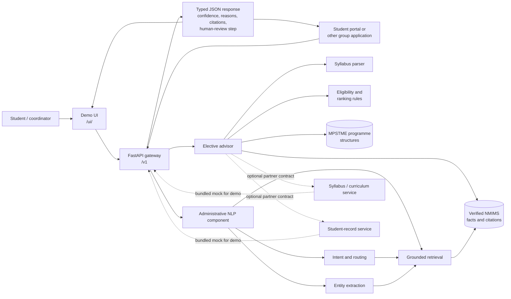

# Final architecture

The Group 10 component is a stateless FastAPI service. The browser demo and
other University AI components use the same versioned HTTP contracts, so the
demo is also an integration test of the deployable application.

## Runtime boundaries

- **Inputs:** free-text academic identity, one or more syllabus texts/files,
  or a partner topic and student ID.
- **Decision layer:** parses each syllabus, matches the student to the
  published programme structure, checks semester/slot/level/prerequisites,
  and ranks only eligible courses.
- **Safety boundary:** the service recommends; it does not enrol a student.
  Every response includes citations, uncertainty, and coordinator checks.
- **Integration boundary:** partner services are called through explicit
  `GET /syllabi?topic=` and `GET /students/{id}` contracts. Until configured,
  in-process mocks provide the same contract for the demonstration.
- **Persistence:** requests are stateless and partner responses are not
  stored. The catalogue and verified facts are versioned repository inputs.

## Key endpoints

| Endpoint | Purpose |
|---|---|
| `POST /v1/electives/advise` | Recommend an elective from identity and syllabi |
| `POST /v1/electives/parse` | Inspect fields extracted from one syllabus |
| `POST /v1/electives/advise-from-partners` | Run the cross-component flow |
| `POST /v1/analyze` | Understand and route an administrative question |
| `GET /v1/manifest` | Service-registry capability and contract card |
| `GET /docs` | Interactive OpenAPI documentation |
| `GET /ui/` | Final demonstration web app |
